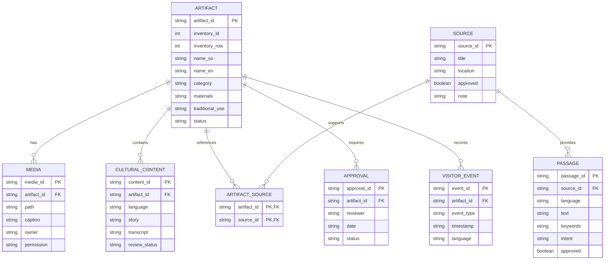

# KHAYRHAYE LIVING HERITAGE
## Data Relationship Diagram v0.1

Status: Draft
Pilot Scope: KHH-001 to KHH-005

### Entity Relationship Diagram

### Implementation Notes

1. This diagram represents the proposed conceptual
   relational database structure.

2. The current pilot uses JSON files rather than
   normalized relational database tables.

3. ARTIFACT_SOURCE is a proposed junction entity
   allowing one inventory source to support
   multiple museum artifacts.

4. The visitor-event relationship is part of the
   architecture design and does not indicate that
   a public analytics system is deployed.

5. Publication requires image permission and
   museum approval.

### Xedho Example

Artifact: KHH-005

Inventory: 5

Source: INV-005

Media: assets/xedho.png

Cultural Content:
- Somali draft story
- English draft story

Source Passages: 6

Approval Status: Pending
